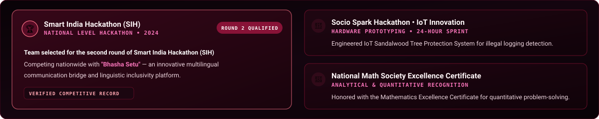
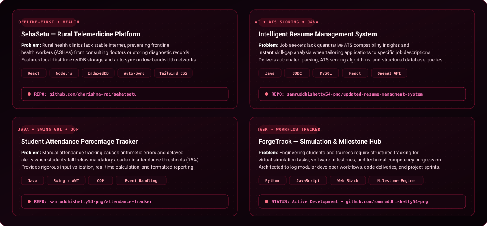
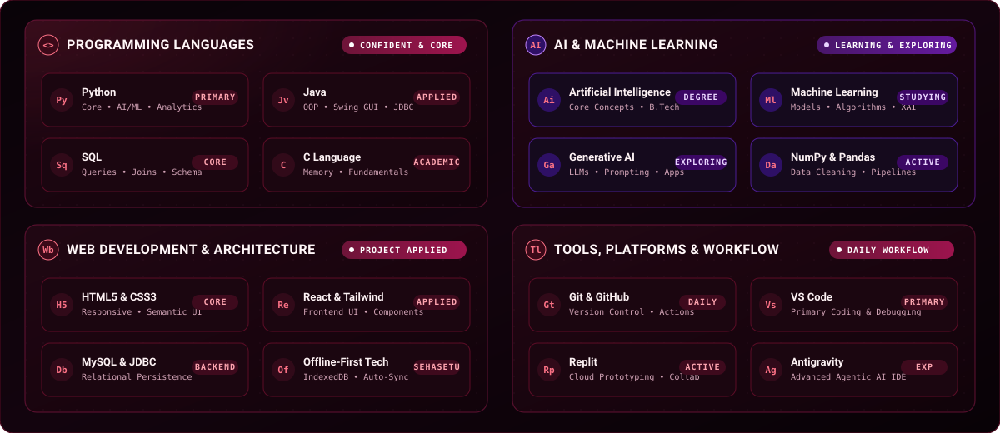

<!-- HERO BANNER -->

  

<!-- QUICK NAV -->

  <a href="#-about-me"><b>About</b></a> &bull;
  <a href="#-achievements"><b>Achievements</b></a> &bull;
  <a href="#-featured-projects"><b>Featured Projects</b></a> &bull;
  <a href="#-technical-skills"><b>Technical Skills</b></a> &bull;
  <a href="#-github-contributions"><b>Contributions</b></a> &bull;
  <a href="#-connect-with-me"><b>Connect</b></a>

<!-- SECTION DIVIDER -->

## 💫 About Me

Hey there! I'm **Samruddhi Shetty**, an engineering student passionate about technology, problem-solving, and building meaningful projects.

I'm exploring the world of **Artificial Intelligence and Machine Learning**, while strengthening my programming and software development skills.

I believe in learning by building, experimenting with new ideas, and continuously improving myself.

- 🔭 **Focus**: Exploring AI/ML and building practical projects.
- 🌱 **Learning**: Currently learning Machine Learning, Java, and DSA.
- 💡 **Interests**: Generative AI, intelligent applications, and offline-first systems.
- 🤝 **Collaboration**: Open to learning and collaborating on innovative projects.
- ⚡ **Philosophy**: Always curious, always learning!

> [!NOTE]
> **Education**: **B.Tech in Artificial Intelligence and Machine Learning** (2024 &ndash; 2028)  
> **Institution**: [Sahyadri College of Engineering and Management](https://sahyadri.edu.in), Mangalore, Karnataka  
> **Academic Highlights**: Current CGPA: 8.79 &bull; Pre-University (PCMB): 95% &bull; SSLC: 91%

  

## 🏆 Achievements

  

 

- 🥇 **Smart India Hackathon (SIH) &bull; Selected for Round 2**  
  Selected for the second round of the prestigious nationwide Smart India Hackathon with **"Bhasha Setu"** &mdash; an innovative linguistic inclusivity and multilingual communication bridge platform.
- 🌲 **Socio Spark Hackathon &bull; IoT Innovation**  
  Engineered the **Sandalwood Tree Protection System**, an IoT-based anti-poaching prototype utilizing vibration sensors and real-time alert dispatch to assist forest authorities in preventing illicit logging.
- 📐 **National Math Society &bull; Mathematics Excellence Award**  
  Honored with the **Mathematics Excellence Certificate** recognizing quantitative distinction and analytical problem-solving.
- ⚡ **Competitive Problem Solving &amp; Hackathons**  
  Active participant in fast-paced collaborative innovation sprints, including the **Witch Hunt Hackathon** and **Navonmesha Hackathon**.

  

## 🚀 Featured Projects

  

 

### 1. [SehaSetu &mdash; Rural Healthcare &amp; Telemedicine Platform](https://github.com/charishma-rai/sehatsetu)
- **Problem Statement**: Remote and rural healthcare centers frequently suffer from unstable or absent internet connectivity. Frontline health workers (ASHAs) struggle to record vital diagnostic trends or consult with city doctors without losing critical patient histories.
- **Solution**: Developed an offline-first telemedicine architecture featuring local-first IndexedDB persistence, background synchronization protocols when internet returns, and lightweight REST payloads optimized for 2G/3G connectivity.
- **Technologies Used**: `React` &bull; `Node.js` &bull; `Express` &bull; `IndexedDB` &bull; `Tailwind CSS` &bull; `Auto-Sync Protocols`
- **Repository**: [github.com/charishma-rai/sehatsetu](https://github.com/charishma-rai/sehatsetu)
- **Architecture**: Offline-First Local Storage &bull; Clinician Dashboard &bull; Rural Health Records

---

### 2. [Intelligent Resume Management System](https://github.com/samruddhishetty54-png/updated-resume-managment-system)
- **Problem Statement**: Campus placement candidates lack instant quantitative ATS evaluation and tailored feedback, making it difficult to optimize resumes against specific job descriptions and detect skill gaps before applying.
- **Solution**: Built an AI-powered full-stack web application that parses candidate resumes, computes ATS compatibility scores against target job roles, highlights missing skills, and delivers personalized recommendations.
- **Technologies Used**: `Java` &bull; `JDBC` &bull; `MySQL` &bull; `React` &bull; `TypeScript` &bull; `Tailwind CSS` &bull; `OpenAI API`
- **Repository**: [github.com/samruddhishetty54-png/updated-resume-managment-system](https://github.com/samruddhishetty54-png/updated-resume-managment-system)
- **Architecture**: Relational Database Persistence &bull; Automated ATS Parsing &bull; AI Recommendation Engine

---

### 3. [Student Attendance Percentage Tracker](https://github.com/samruddhishetty54-png/attendance-tracker)
- **Problem Statement**: Manual attendance tracking is error-prone and often fails to provide immediate warning signals when a student's attendance drops below mandatory academic criteria (e.g., 75% cutoff), leading to unexpected examination shortages.
- **Solution**: Developed an interactive Java desktop application with rigorous input validation, real-time percentage computation, shortage status detection, and formatted report output.
- **Technologies Used**: `Java` &bull; `Java Swing (GUI)` &bull; `AWT Event Handling` &bull; `Object-Oriented Programming (OOP)`
- **Repository**: [github.com/samruddhishetty54-png/attendance-tracker](https://github.com/samruddhishetty54-png/attendance-tracker)
- **Architecture**: Desktop Event-Driven UI &bull; Boundary Input Validation &bull; Real-Time Report Generator

---

### 4. [ForgeTrack &mdash; Simulation &amp; Milestone Hub](https://github.com/samruddhishetty54-png)
- **Problem Statement**: Tracking complex software development sprints, virtual industry simulations (such as the Forage work experience program), and technical milestones across emerging technology projects requires structured milestone logging and visibility.
- **Solution**: Architected a developer tracking system designed to organize software engineering tasks, log simulation deliverables, track algorithmic progress, and visualize technical competency growth.
- **Technologies Used**: `Python` &bull; `JavaScript` &bull; `Web Architecture` &bull; `Task & Milestone Engine`
- **Repository**: [github.com/samruddhishetty54-png](https://github.com/samruddhishetty54-png) *(Active Development / Academic Project)*
- **Architecture**: Modular Workflow Logger &bull; Milestone Tracker &bull; Sprint Dashboard

  

## 💻 Technical Skills

  

 

| Category | Confidently Used &bull; Applied | Currently Learning &bull; Exploring |
| :--- | :--- | :--- |
| **Programming** | **Python**, **Java** (OOP, Swing, JDBC), **SQL**, **C** | Data Structures &amp; Algorithms in Java |
| **AI &amp; Machine Learning** | Fundamental AI Concepts, Data Processing (**NumPy**, **Pandas**) | **Machine Learning** models, **Generative AI**, **Scikit-Learn**, Explainable AI (XAI) |
| **Web Development** | **HTML5**, **CSS3**, **React**, **Tailwind CSS**, JavaScript | Full-Stack REST API Architectures, Offline-First Sync |
| **Databases** | **MySQL**, **JDBC** Connection Management | Database Indexing &amp; Query Optimization |
| **Developer Tools** | **Git**, **GitHub**, **VS Code**, **IntelliJ IDEA**, **Replit**, **Antigravity** | Continuous Integration &amp; Deployment Workflows |

  

## 📊 GitHub Contributions &amp; Activity

<!-- GENUINE GITHUB CONTRIBUTION GRAPH -->

  

<!-- GITHUB METRICS IN BURGUNDY PALETTE -->

&nbsp;&nbsp;

  

## 🌐 Connect With Me

  Feel free to reach out for project collaborations, technical discussions, or opportunities in AI/ML!

&nbsp;

&nbsp;

  

<!-- ANIMATED FOOTER -->

